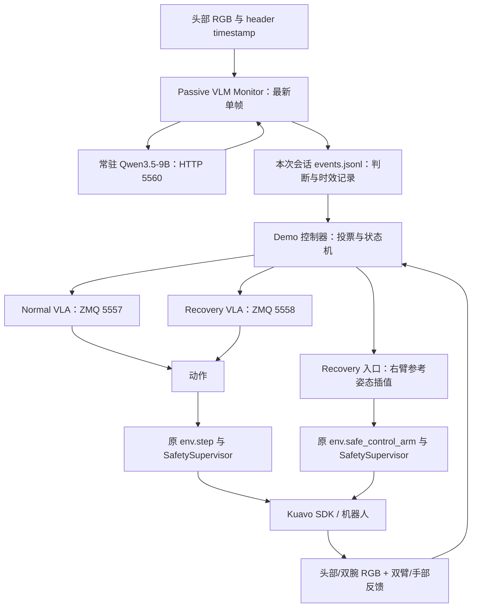

# Kuavo Package Sorting：VLM + VLA 完整操作 Pipeline

更新日期：2026-11-04。根据本次工作区代码和 YAML 整理，当前分支为 `lingbot_vlm_vla_progress`。后续参数修改以实际配置及每次运行保存的 settings/session 为准，不以聊天中的历史数值为准。

本文包含环境、相机、模型常驻、纯相机测试、单技能测试、自动 Demo、切换规则、日志检查、退出与换 checkpoint 流程。下面的启动命令供操作者执行；编写文档本身不会启动训练、模型、ROS 或机器人。

## 1. 系统分工与数据流



- Qwen 只返回场景类别，不直接发动作。
- 两个 VLA server 常驻，各自保留模型权重与动作缓存；只有当前被选中的技能生成/提供动作，不代表两套 VLA 同时控制机器人。
- Demo 控制器读取 Monitor 判断，调用对应 server，并通过现有机器人环境提交动作。
- 技能切换会重置服务端缓存，不重新加载权重，也不在切换时调用 `env.reset()`。
- VLM 与 VLA 分进程并行；当前 VLA 客户端是同步动作提交方式，`async_inference: false`。这不影响 VLM 在另一进程并行运行。
- 单独运行 Passive Monitor 时只有观察与记录；由 `eval.py` 菜单9启动 Demo 时，外层控制器才会自动切换技能。

## 2. 文件与配置分工

| 文件 | 用途 |
|---|---|
| `configs/deploy/deploy_lingbot_package.yaml` | Normal/Recovery 共用的机器人、相机、控制配置 |
| `configs/deploy/total/deploy_total.yaml` | 部署默认值、话题、关节映射、异步选项等 |
| `configs/deploy/lingbot_skill_demo.yaml` | 自动 Demo 的模型服务连接、Prompt、投票、超时、Recovery 入口参数 |
| `configs/server/lingbot_package_skills.yaml` | 自动 Demo 的 Normal/Recovery checkpoint、训练配置、norm stats、5557/5558端口 |
| `configs/server/launcher.yaml` | 原有单模型 launcher 的配置，通常5555；不是双技能 Demo 的 checkpoint 配置 |
| `vlm_test/prompts/package_front_edge_tolerant_v4.json` | 当前 VLM 场景分类 Prompt |
| `vlm_test/qwen_service.py` | 单独常驻加载 Qwen |
| `vlm_test/skill_service.py` | 单独常驻加载两个 VLA checkpoint |
| `vlm_test/passive_vlm_monitor.py` | ROS 相机订阅、单帧判断、时效检查、图片与判断记录 |
| `kuavo_deploy/eval.py` | 用户操作入口 |
| `kuavo_deploy/src/scripts/script_skill_demo.py` | 自动技能控制器 |
| `kuavo_deploy/utils/recovery_entry.py` | bag 实测参考读取与右臂入口轨迹 |

`deploy_lingbot_package.yaml` 中 `pretrained_path` 在 client 模式不选择服务端 checkpoint。单独运行与双技能 Demo 使用的 server 配置不同，修改前先确定启动模式。

### 当前模型快照

| 服务 | 模型 | 端口 | 当前分配方式 |
|---|---|---|---|
| Qwen | `/media/data/jiayi/hf_model/Qwen3.5-9B`，NF4 权重、BF16计算 | HTTP `127.0.0.1:5560` | 独立终端 `CUDA_VISIBLE_DEVICES=0` 示例 |
| Normal | `task3_pacakge_lora/global_step_66480/hf_ckpt` | ZMQ `127.0.0.1:5557` | skill_service 默认读 `vla_gpu: "1"` |
| Recovery | `task3_package_lora_failure/package_below_target_zone/vlm_action_bs16_ga1_vs8/checkpoints/global_step_39620/hf_ckpt` | ZMQ `127.0.0.1:5558` | 与 Normal 同一张卡 |

Normal checkpoint 完整路径：

```text
/media/data/jiayi/outputs/kuavo_lingbotvla/task3_pacakge_lora/global_step_66480/hf_ckpt
```

Recovery checkpoint 完整路径：

```text
/media/data/jiayi/outputs/kuavo_lingbotvla/task3_package_lora_failure/package_below_target_zone/vlm_action_bs16_ga1_vs8/checkpoints/global_step_39620/hf_ckpt
```

两者的 `training_config_path` 均指向各自 `hf_ckpt/lingbotvla_cli.yaml`，norm 分别为：

```text
/home/kuavo/jiayi/kuavo_learning_studio/kuavo_model/external_models/lingbot-vla/assets/norm_stats/kuavo_package.json
/home/kuavo/jiayi/kuavo_learning_studio/kuavo_model/external_models/lingbot-vla/assets/norm_stats/task3_package_failure/task3_package_below_target_zone.json
```

当前双技能 server：`which_arm: both`、`execution_horizon: 25`、`num_denoising_step: 10`、`use_compile: false`、`use_fp32: false`。训练 chunk 为50帧，服务取前25步使用；10 Hz 是动作控制频率，并非每秒完整模型推理10次。

## 3. 一次完整运行的终端分配

| 终端 | 工作 | 是否允许产生机器人动作 |
|---|---|---|
| A | Qwen 常驻服务 | 否 |
| B | 两个 VLA checkpoint 常驻服务 | 否，只生成/提供动作 |
| C | `eval.py` / 自动 Demo | 是 |
| D（可选） | `tail` 日志或只读相机检查 | 否 |

不要在自动 Demo 运行时再启动其他机器人动作客户端。纯相机测试也不要与 Demo 同时持续请求同一个 Qwen 服务：该服务一次只接受一个推理请求，忙时拒绝，不为旧帧排队。

## 4. 环境与相机准备

项目目录：

```bash
cd /home/kuavo/jiayi/kuavo_learning_studio
```

当前使用两个 conda 环境：

- `lingbotvla`：模型服务、机器人 SDK、`eval.py`。
- `qwen35`：Qwen、Transformers、bitsandbytes、Monitor。

项目根目录 `.venv` 已删除，不再执行 `source .venv/bin/activate`。终端如果还残留旧激活状态，先 `deactivate`，再激活需要的 conda 环境。`kuavo_learning_studio.egg-info` 是项目安装元数据，已保留。

需要 ROS 的终端沿用已确认的机器人 ROS 网络配置，并加载 ROS：

```bash
source /opt/ros/noetic/setup.bash
conda activate lingbotvla
cd /home/kuavo/jiayi/kuavo_learning_studio
```

以下是只读检查：

```bash
echo "$ROS_MASTER_URI"
rostopic info /cam_h/color/image_raw/compressed
rostopic echo -n 1 /cam_h/color/image_raw/compressed/header
date +%s
rostopic hz /cam_h/color/image_raw/compressed
```

`rostopic hz` 持续显示，按 Ctrl+C 退出。不要把 ROS header 的设备运行秒数与 Unix 系统时间混用。头相机此前已由操作者将 Orbbec 的 `time_domain` 设置为 `system`；若重新部署后出现时钟域问题，应检查相机发布端，不在接收端重写时间戳。

| 来源 | 话题 |
|---|---|
| 头部 | `/cam_h/color/image_raw/compressed` |
| 左腕 | `/cam_l/color/image_raw/compressed` |
| 右腕 | `/cam_r/color/image_raw/compressed` |
| 双臂反馈 | `/sensors_data_raw` |
| 灵巧手反馈 | `/dexhand/state` |

VLM 只读取头部；VLA 使用三路图像和16维状态（左臂7＋左手1＋右臂7＋右手1）。自动 Demo 会校验这些来源的最新时间戳。

### 不加载模型的 Monitor probe

```bash
/home/kuavo/miniforge3/envs/qwen35/bin/python -m vlm_test.passive_vlm_monitor \
  --deploy-config configs/deploy/deploy_lingbot_package.yaml \
  --probe-only
```

只订阅检查约5秒，不加载 Qwen，不调用 VLA，不发送动作。`camera_source_confirmed` 记录实际 publisher、frame_id、时间戳。没有 ROS feed 时不会得到有效 probe。

若相机未启动，沿用机器人已有相机启动流程。历史确认相机运行在 `kuavo-up`，原脚本为：

```bash
# 在 kuavo-up 上、确认没有重复启动的相机进程后执行
bash /home/leju_kuavo/kuavo_data_pilot/src/kuavo_data_pilot_bin/scripts/start_camera.sh
```

该脚本读取 `/etc/kuavo.conf` 并导出腕部相机序列号；单独 roslaunch 曾因 `CAMERA_LEFT` 未设置而失败。本文不要求重启机器人或运控；相机已有正常发布时跳过启动步骤。

## 5. 终端 A：常驻加载 Qwen

```bash
cd /home/kuavo/jiayi/kuavo_learning_studio
CUDA_VISIBLE_DEVICES=0 \
  /home/kuavo/miniforge3/envs/qwen35/bin/python -u -m vlm_test.qwen_service \
  --precision nf4
```

等到：

```text
Qwen ready: http://127.0.0.1:5560
```

回车或保持终端开启即可保持权重；`q` / `quit` / `exit` 或 Ctrl+C 关闭。服务加载一次，后续每次 Demo 重用，不保留对话历史，不导入机器人控制接口。

可在另一个终端只读查看服务声明的模型与精度：

```bash
curl --max-time 5 http://127.0.0.1:5560/metadata
```

`--precision bf16` 可改为BF16加载，但须同时把 Demo 的 `vlm_precision` 改为 `bf16`，关闭旧 Qwen 后重新加载。客户端要求精度和模型路径匹配，配置变化不会自动改变已经加载的模型。NF4 不保证比 BF16 更快，比较时应固定 GPU、输入、Prompt、输出限制并测量延迟与准确率。

GPU 说明：常驻 Qwen 的卡由本终端的 `CUDA_VISIBLE_DEVICES` 指定；Demo YAML 的 `vlm_gpu` 不能把已经加载的 Qwen 移到另一张卡。

## 6. 终端 B：常驻加载 Normal / Recovery checkpoint

```bash
conda activate lingbotvla
cd /home/kuavo/jiayi/kuavo_learning_studio
python -u -m vlm_test.skill_service
```

默认读取 `configs/deploy/lingbot_skill_demo.yaml`，目前 `vla_gpu: "1"`。显式指定同样的卡可用：

```bash
python -u -m vlm_test.skill_service --gpu 1
```

以上两条选择一条执行，不要同时启动两份。等到：

```text
normal: server_ready
recovery: server_ready
Skills ready
```

- 保持终端开启或回车：保留权重。
- `q` / `quit` / `exit`、Ctrl+C：关闭两个模型 server。先结束正在运行的 Demo。
- 加载只做模型初始化和 metadata 查询，不构造机器人环境，不执行机器人动作。
- `outputs/skill_servers/current.json` 保存端口对应的 checkpoint/config/norm、日志目录、GPU和私有令牌。不要公开完整文件。
- 服务进程持有 owner lock；Demo 持有 client lock，一套常驻服务只允许一个 Demo 客户端占用。
- 端口5557/5558需空闲；旧5555服务不会被本脚本自动结束，但可能占用显存。

## 7. 终端 C：配置检查及自动 Demo

```bash
source /opt/ros/noetic/setup.bash
conda activate lingbotvla
cd /home/kuavo/jiayi/kuavo_learning_studio
python kuavo_deploy/eval.py
```

按提示输入：

```text
/home/kuavo/jiayi/kuavo_learning_studio/configs/deploy/deploy_lingbot_package.yaml
```

当前入口通过交互式输入读取配置，不要依赖把配置作为 eval.py 位置参数传入。

1. 选择菜单 **10**：检查配置与模型文件路径，不启动模型、不初始化 ROS/机器人、不验证实际服务或实时相机可用性。
2. 常驻服务均 ready、相机与机器人原有部署条件准备完成后，选择菜单 **9**：执行自动 Demo，无额外人工切换确认。
3. Demo 检查当前服务 metadata 与配置匹配，重置技能缓存，启动本次 Passive Monitor。
4. 等待连续稳定的新鲜分类，然后调用原环境初始化（`env.reset()`，可能改变控制模式、头部/手部状态），初始化后再重新获取稳定判断。
5. 进入 Normal 或按当前场景进入 Recovery 切换流程。

同一 deploy YAML 同时用于 Normal 与 Recovery，不在切换时重新建环境。菜单9使用 Demo 配置中的 `normal_instruction` / `recovery_instruction`；菜单2的单技能推理则使用部署配置的 `inference.task_prompt`，两者不要混淆。

直接命令是同一功能的替代入口，不要与 eval.py 中正在执行的任务并行：

```bash
# 仅配置检查
python kuavo_deploy/src/scripts/script_skill_demo.py \
  --config configs/deploy/deploy_lingbot_package.yaml --preflight

# 实际自动执行：操作者准备好后才运行
python kuavo_deploy/src/scripts/script_skill_demo.py \
  --config configs/deploy/deploy_lingbot_package.yaml --execute
```

当前部署 `safety_enabled: true`、`safety_task: package_recovery`；必须保持 client、同步、both、qiangnao 1DOF、frame_alignment=false。启动检查失败会显示具体字段。

当前 `max_episode_steps` 被设为极大的整数，不能把它当作有效的时间限制；Demo 另有600秒配置时限。实际总耗时也受初始化、阻塞RPC、复核等阶段影响，不是硬实时停止保证。需要固定步数实验时自行设置明确的步数；Recovery 动作不消耗 Normal 的步数预算。

### 运行中交互

- `p` / `pause`：暂停/恢复动作提交。
- `s` / `stop`：停止当前 Demo。
- `l` / `log`：查看实时日志。
- `h` / `help`：帮助。

停止提交不等同于底层已经立即停止运动，机器人可能仍在执行上一条目标，不替代硬件急停。不要从另一个控制客户端并发发动作。

## 8. 只测试 VLM：人工摆放，不运行 VLA

只需正常发布头相机和终端A的 Qwen；不运行终端B和菜单9。

```bash
source /opt/ros/noetic/setup.bash
cd /home/kuavo/jiayi/kuavo_learning_studio
/home/kuavo/miniforge3/envs/qwen35/bin/python -u -m vlm_test.passive_vlm_monitor \
  --deploy-config configs/deploy/deploy_lingbot_package.yaml \
  --camera-only \
  --qwen-service-url http://127.0.0.1:5560 \
  --precision nf4
```

`VLA=not_monitored` 正常。该模式不读取 VLA 执行日志或 pause/stop信号。按 Ctrl+C 结束 Monitor，常驻 Qwen 保留。默认会读历史 ROI 文件作为审计快照，但不使用旧坐标裁剪、判断或向模型发送第二张参考图。

依次摆放正常平台位置、轻微边角悬出、明确滑入近侧低位、放回平台，每个稳定位置保持几秒，将手移开后对照保存的图片判断效果。不要把程序预测直接当成真实标签。

## 9. 单独测试一个 VLA checkpoint

用于区分“VLM/切换问题”与“技能模型本身问题”。这是有机器人动作的模式，不能与菜单9同时运行。

原有单模型 server 使用 `configs/server/launcher.yaml` 的 `lingbotvla` 配置（通常5555）；核对 checkpoint、对应训练 YAML 和 norm，并确认部署客户端指向该 server。

```bash
conda activate lingbotvla
cd /home/kuavo/jiayi/kuavo_learning_studio
CUDA_VISIBLE_DEVICES=1 python kuavo_server/launch.py lingbotvla \
  --config configs/server/launcher.yaml
```

等单模型服务初始化完成，再在加载ROS的另一个终端运行 `eval.py`，输入同一 deploy YAML，选择菜单 **2**（原 Normal/单技能推理入口）。此时不按 VLM 自动切换。菜单2的技能取决于该 server 实际加载的 checkpoint，而不取决于菜单名称或本地 `pretrained_path`。

单测 Recovery 时使用与训练相同的任务文本，并检查真实机器人姿态/画面是否处于演示分布。不要伪造输入state或自动把机器人强行设为训练姿态来掩盖偏差。单模型5555和双技能5557/5558是两套加载流程。

## 10. VLM 的输入、Prompt 与时效

实际 Prompt：`vlm_test/prompts/package_front_edge_tolerant_v4.json` 中的 `skill_prompt`，不是整个JSON元数据。可只读打印：

```bash
python - <<'PY'
import json
from pathlib import Path
p = Path('vlm_test/prompts/package_front_edge_tolerant_v4.json')
print(json.loads(p.read_text())['skill_prompt'])
PY
```

- 单张当前 RGB，默认缩到宽640、高度按比例且取偶数；保存模型实际输入PNG。不是视频窗口，没有多帧历史。
- 每秒尝试采样，上一轮没结束则跳过，不排队；实际有效判断频率可能低于1Hz。
- 禁用 thinking，greedy，最多24个新token；严格只接受 `{"skill":"normal"}` 或 `{"skill":"recovery"}`。
- 每帧重新辨认黄色平台及机器人近侧前缘，不使用固定ROI、不只看白色运单。
- 主体和普通抓取位置仍在平台上的轻微边角悬出为 normal；主体/普通抓取区域明显滑入近侧较低位置为 recovery，不要求掉到地面。
- 左侧供料区、右侧篮子、无滑落包裹的空平台为 normal。多包裹只要一个明确处于滑落恢复位置即 recovery。
- 人手靠近、机器人是否运动/VLA是否运行本身不决定分类；遮挡不自动等于滑落。
- 模型判断的是当前包裹位置，不是动作完成证明。参考图片不作为额外模型输入。

| 参数 | 当前值 | 含义 |
|---|---:|---|
| Monitor采样周期 | 1秒 | 忙时跳过 |
| Monitor输入帧最大年龄 | 0.5秒 | 使用header和接收时钟校验 |
| `max_vlm_result_age` | 1.5秒 | 以输入帧时间而非只以完成时间计龄 |
| `max_observation_age` | 0.5秒 | VLA图像、关节、手部数据最新年龄 |
| `recovery_hits` / `normal_hits` | 3 / 3 | 不同有效帧的连续同类票数 |
| `max_vote_gap_seconds` | 2.5秒 | 相邻有效判断的图像时间戳间隔上限 |

重复读取同一结果不会增票；相反标签、无效输出或拒绝的旧结果会打断计数，间隔过长重新计数。旧结果过期不回退为 normal。

## 11. 技能进入、执行与退出

### 11.1 Normal → Recovery

1. Normal期间累计3次新鲜 recovery。
2. 在同步动作边界停止 Normal，清空其动作缓存；若触发在推理期间到达，丢弃尚未提交的那条动作。
3. 根据实际关节反馈停稳，记录 `STOPPING_NORMAL`；停稳窗口0.5秒，最大位置变化0.015 rad、最大速度0.05 rad/s，等待上限8秒。
4. 清空旧票数，记录 `VERIFY_SWITCH`。只用停稳后拍摄的新帧，3次normal则取消恢复，记录 `RECOVERY_CANCELLED_NORMAL_RESUMED`；3次recovery则继续入口。单次跳变只等待，最多60秒。
5. 当前启用右臂预定位，见下一节。预定位后记录 `VERIFY_AFTER_RIGHT_ARM_ENTRY`，再清空旧票、复核新场景；3次normal仍可取消恢复，3次recovery才进入技能。
6. 清空 Recovery 缓存，创建本次手部阶段记录，进入 `RECOVERING`。真正进入才增加 Recovery 次数，最多3次；再次需要第4次会退出。

### 11.2 右臂预定位（当前启用，会移动机器人）

原因：Recovery演示中的右臂姿态较集中，Normal执行后的真实右臂状态可能偏离训练分布。此步骤是明确的入口动作，不是伪造模型state，也不是模型权重的一部分。

参考来自以下bag的第一条实测 `/sensors_data_raw` 消息中的右臂关节，具体slice复用当前部署映射：

```text
/media/data/training_data/task3_package_pick_and_place_failure/package_below_target_zone/vr_record_2026-10-22-12-10-32.bag
```

| 参数 | 当前值 |
|---|---:|
| 最短规划时间 | 3秒，按速度/加速度界限自动延长 |
| 轨迹发送频率 | 100 Hz，系统延迟可能拉长实际时间 |
| 每关节最大规划速度 | 0.25 rad/s |
| 每关节最大规划加速度 | 0.5 rad/s² |
| 右臂到位最大绝对误差 | **0.04 rad**，约2.29° |
| 到位稳定持续时间 | 0.5秒 |
| 轨迹完成后的到位等待 | 30秒 |
| 左臂偏离保持目标上限 | 0.10 rad |

保持左臂上一条发送目标（没有则用当前反馈），不发送手指动作；五次插值的每条14维关节命令通过现有 `safe_control_arm` 和SafetySupervisor。到位依据实际反馈，非SDK返回成功。规划有速度/加速度约束，不包含碰撞检测。

曾出现右臂第4关节稳定误差约0.03624 rad，原0.03 rad容差无法通过；操作者已批准改为0.04 rad。不要仍按旧0.03解释新运行。

### 11.3 Recovery → Normal

1. Recovery开始后，初始阶段 `waiting_for_grasp`；初始张手和任何短暂normal均不算动作完成。
2. 左手最近已提交命令≥0.5，实际反馈≥0.25，持续≥0.3秒：`grasp_observed`。
3. 随后左手命令与实际反馈均≤0.15，持续≥0.5秒：`released`。
4. 阶段变化清空旧票，只接受释放后拍摄的连续3次normal，且本次Recovery已执行至少2秒，才停止Recovery进入 `VERIFY_RECOVERY`。
5. 清缓存、停稳，再使用停稳后连续3次新鲜normal且左手仍张开，才回到 `NORMAL_RESUMED`。
6. 再次闭手会撤销释放状态。手部采样中断不累计稳定时间。一次Recovery最多180秒，停止后复核最多60秒。

这些阈值是可调的手部动作阶段代理，没有证明物体已被抓住/释放；未完成接触或任务成功标定。若一直waiting_for_grasp，检查原始左手预测及真实反馈，不直接降低阈值把失败判成成功。

### 11.4 监控不可用和其他退出

| 情况 | 当前处理 |
|---|---|
| 超过3秒无有效VLM判断 | `WAITING_FOR_VLM`，停止新动作、清缓存，最多等15秒 |
| 等到连续3次新鲜有效normal/recovery | `VLM_AVAILABLE`，重新评估当前技能、重新推理；丢弃暂停前的动作 |
| 15秒仍未恢复稳定判断 | 超时退出 |
| 某次切换场景判断不稳定 | 最多等待60秒，不自动把未知当normal |
| 右臂未到位/左臂漂移 | 入口终止，不执行Recovery |
| 动作/反馈无效或过期、服务/RPC故障、Safety拒绝 | 退出并记录fault |
| Normal步数预算/环境done | `DEMO_STEP_LIMIT_OR_ENV_DONE`，不等于任务成功 |
| Recovery180秒/次数上限/Demo配置总时限 | 退出 |
| 操作者停止 | 停止提交动作，清理本次客户端/Monitor，常驻权重保留 |

RPC接收超时当前15000ms，执行中的同步RPC可能延迟上层检查/响应；这些超时不是硬件急停保证。暂停/等待的时间也可能消耗技能或Demo的墙钟时限。

SafetySupervisor当前检查有限数值/维度、初始目标偏差、相邻命令变化和命令跟踪偏差；Normal与Recovery共用 `package_recovery` profile。它不是碰撞检测、力控或完整硬件安全系统。不要因为模型没有产生抓取动作而关闭此保护。

## 12. 日志、图片和状态查询

所有会话目录名以 **UTC（Z）** 命名；终端logger通常使用主机本地时间。柏林冬令时UTC+1，夏令时UTC+2，跨日期比较时使用事件UTC时间/Unix时间，不固定加一小时。

### 12.1 各类日志的实际位置

```text
outputs/skill_servers/<UTC时间>/
  normal_server.log          # Normal checkpoint加载日志
  recovery_server.log        # Recovery checkpoint加载日志
  decisions.jsonl            # 常驻服务启动/就绪事件

outputs/skill_demo/<UTC时间>/
  settings.json              # 本次Demo配置快照
  decisions.jsonl            # 状态、VLM票数、动作提交、入口反馈、故障与结束
  vlm_monitor.log            # 本次Monitor的stdout/stderr
  monitor/<UTC会话>/
    session.json             # Prompt正文、相机、模型精度、时效、resize等
    events.jsonl             # 每次判断的输入图片、header、原始输出、解析、耗时与是否接受
    latest_status.json       # 当前呈现状态（文件名以实际目录为准）
    monitor.log
    images/*.png             # 模型实际输入图像

outputs/passive_vlm_monitor/<UTC会话>/
  ...                       # 单独Monitor/camera-only/probe日志

log/kuavo_deploy/kuavo_deploy.log
                              # eval.py当前任务合并日志，每次任务启动可能覆盖
```

常驻模式下 checkpoint 加载日志在 `outputs/skill_servers/`，不在每个 `skill_demo` 目录重复生成。Qwen常驻加载信息在终端A；需要永久保存时可由操作者用终端日志功能保存。不要分享包含令牌的current.json。

### 12.2 查询最新Demo状态（只读，不触发动作）

```bash
cd /home/kuavo/jiayi/kuavo_learning_studio
python - <<'PY'
import json
from pathlib import Path
from datetime import datetime
from zoneinfo import ZoneInfo
runs = [p for p in Path('outputs/skill_demo').iterdir() if p.is_dir()]
if not runs:
    raise SystemExit('没有Demo会话')
run = max(runs, key=lambda p: p.name)
rows = []
for line in (run / 'decisions.jsonl').open():
    try:
        rows.append(json.loads(line))
    except json.JSONDecodeError:
        pass  # 可能正在写最后一行
print('会话:', run)
for kind in ['state', 'action_submission', 'recovery_gripper_stage', 'fault', 'stopped', 'finished']:
    items = [r for r in rows if r['event'] == kind]
    if items:
        r = items[-1]
        stamp = datetime.fromtimestamp(r['wall_s'], ZoneInfo('Europe/Berlin')).isoformat()
        print(stamp, {k: v for k, v in r.items()
                      if k not in ['action', 'trigger', 'evidence', 'wall_s', 'mono_s']})
PY
```

最后的 `action_submission.active_skill` 表示最后提交的技能；如果其后已有fault/finished，它不代表当前仍在运行。单条VLM recovery也不代表已执行技能，需查 `RECOVERING` 和对应动作。控制器状态通过不等于人工确认任务成功。

### 12.3 实时看日志

```bash
tail -f log/kuavo_deploy/kuavo_deploy.log
```

指定会话时，将目录换成实际运行目录：

```bash
tail -f outputs/skill_demo/<UTC时间>/decisions.jsonl
# checkpoint加载
tail -f outputs/skill_servers/<UTC时间>/normal_server.log \
         outputs/skill_servers/<UTC时间>/recovery_server.log
```

`<UTC时间>` 是占位符，替换后再执行；它不是可直接复制的目录名。

### 12.4 对照图片检查VLM

在 `monitor/<会话>/events.jsonl` 找 `event=judgment`，使用该行：

- `input_image`：对应本次送给模型的PNG；不要用另一秒的截图解释该判断。
- `frame.stamp_s` / `stamp_ns`：相机采集时间。
- `completed_at_utc` / `completed_ros_s`：推理完成时间。
- `raw_output` / `parsed`：模型原始文本与解析结果。
- `status` / `accepted_current`：是否通过时效/格式检查。看到了normal文本但结果被拒绝时，不计入控制器投票。
- `timing` 与 `worker_total_seconds`：模型生成与整个worker耗时；端到端还需要结合采集和完成时间。

Monitor的输出本身不执行动作；它曾使用过record-only提示语。实际技能切换看Demo的 `decisions.jsonl`。

### 12.5 右臂误差诊断

`right_arm_entry_feedback` 每约0.5秒记录目标、实测、逐关节误差、worst_joint、容差与剩余等待时间。失败时 `right_arm_entry_timeout` 和fault记录具体关节。稳定偏差不会因为延长等待自然消失；应检查参考、底层跟踪和经过批准的容差。

## 13. 常见问题与处理

| 现象/报错 | 检查和处理 |
|---|---|
| 找不到current.json | 先启动skill_service，等Skills ready；不是创建空文件 |
| Persistent checkpoint configuration differs | 修改配置后旧服务仍加载旧权重；结束Demo并重启skill_service |
| Qwen service configuration mismatch | 模型路径或precision与常驻Qwen不同；核对metadata，按需重载Qwen |
| Address already in use / owner lock | 已有服务占端口或同一manifest被占用，先确认旧进程归属，不启动第二份 |
| missing_header_stamp / clock_domain_mismatch | 检查相机发布端时间域和机器对时；不重写接收时间充当采集时间 |
| stale_before_inference / stale_result | 处理或推理超过时效，检查GPU/CPU负载及最新帧来源；不能把过期预测当当前状态 |
| 三次recovery仍没执行Recovery | 查VERIFY_SWITCH、RIGHT_ARM_PREPOSITIONING和VERIFY_AFTER_RIGHT_ARM_ENTRY，可能还在复核或入口动作 |
| 一直waiting_for_grasp | 查左手命令与反馈；检查模型是否停在接近阶段、图像/task/state是否匹配训练 |
| SafetySupervisor rejected | 查violating_joint_names、delta/limit及跟踪偏差，动作未发送；不要直接关闭安全检查 |
| post-stop normal/release verification failed | 停止后未得到稳定normal/张手，结合原图判断滑落、遮挡或分类抖动 |
| Step200后结束 | 查本次实际deploy的max_episode_steps，旧实验曾设200；与模型加载无关 |
| NumPy 1.x / _ARRAY_API 导入警告 | 历史日志在cv_bridge/NumPy组合中出现过；结合后续是否继续初始化判断，不能把警告单独当成本次退出原因。环境修复应另做依赖对照 |

## 14. 换 checkpoint、改参数及重启范围

| 修改内容 | 下次Demo生效 | 还需重启什么 |
|---|---|---|
| 投票次数、间隔、复核/执行超时、入口容差 | 是 | 重新启动Demo即可 |
| VLM Prompt正文/路径、Normal/Recovery任务文本 | 是 | 重启Demo/Monitor；Qwen与VLA权重可保留 |
| Qwen模型、NF4/BF16、GPU | 配置需匹配 | 先结束Demo，重启Qwen服务，再启动Demo |
| VLA checkpoint、training_config_path、norm、服务horizon等 | 配置需匹配 | 先结束Demo，关闭并重启skill_service |
| 相机源/机器人部署参数 | 需重建客户端读取 | 结束Demo后改配置，确认源；重启Demo，必要时重启发布端 |

改双技能权重时同步更新 `configs/server/lingbot_package_skills.yaml` 中的 checkpoint 与对应 training YAML，不要只改 `configs/server/launcher.yaml`。保持各自norm与训练设置一致。不要覆盖旧checkpoint来让路径看起来不变，否则已加载权重和路径元数据可能不一致。

### 可选：训练与HF导出操作

仅需使用已有checkpoint时跳过本节。这些是昂贵、会写训练输出的操作，由操作者另行启动。

```bash
conda activate lingbotvla
cd /home/kuavo/jiayi/kuavo_learning_studio/kuavo_model/external_models/lingbot-vla
bash train.sh tasks/vla/train_lingbotvla.py \
  configs/vla/task3_failure/kuavo_real_lora_package_below_target_zone.yaml
```

训练的输出目录以该YAML为准。`enable_resume: true` 时再次运行会从同输出目录的可用DCP恢复，不是新实验。当前配置 `save_hf_weights: false`，DCP更新不会自动更换服务里已加载的HF。新对照实验使用独立output_dir，保留旧checkpoint、stats、配置和评测结果。

本次写文档时只读取配置，不运行训练或导出。导出LoRA的命令模板（先确认选中的DCP及其训练配置；输出到不存在的新目录）：

```bash
# 把下面两个路径替换为实际选定的DCP和新导出目录
# 以下变量均为任务专用变量，不修改HOME等系统变量。
recovery_dcp='/absolute/path/to/checkpoints/global_step_SELECTED'
recovery_hf='/absolute/path/to/new_export_directory'

test ! -e "$recovery_hf" && \
python scripts/mereg_dcp_to_hf.py \
  --load-dir "$recovery_dcp" \
  --save-dir "$recovery_hf" \
  --model_assets_dir /media/data/jiayi/outputs/kuavo_lingbotvla/task3_package_lora_failure/package_below_target_zone/vlm_action_bs16_ga1_vs8/model_assets \
  --ckpt-manager dcp \
  --merge-lora
```

脚本名实际为 `mereg_dcp_to_hf.py`。确保导出的safetensors、config.json、lingbotvla_cli.yaml与该DCP对应；脚本会向上查找并复制训练YAML，同输出目录续训期间YAML可能已变化，需要核对出处。修改服务配置后重启skill_service才会加载新导出。

Recovery数据：

```text
/media/data/training_data/task3_package_pick_and_place_failure_lerobot/package_below_target_zone/lerobot
```

此前核对为50条演示、9063帧、10Hz，左手动作包含0～1闭合，arm使用相对state的动作转换；norm与该数据匹配。训练与推理应保持三路图像、状态顺序、task及norm一致。历史审计：`outputs/recovery_training_audit/20261028_recovery_training_audit.md`。

历史审计发现训练loss接收action_is_pad但未屏蔽尾部时间padding；本Pipeline文档不代表该问题已经修复。低训练loss、程序阶段通过或一次闭环日志都不证明泛化成功。改变训练实现后另建实验目录，不混用自动续训结果。

## 15. 关闭顺序与下一轮运行

1. 终端C用 `s` 停止Demo，确认finished；退出eval菜单可用8。
2. 继续测试时保持终端A/B运行，修改允许热重读的配置后重新运行Demo，无需重载模型。
3. 全部结束时，终端B输入q关闭两个VLA server。
4. 终端A输入q关闭Qwen。
5. 相机/运控按机器人原有流程处理，不由本Demo自动重启或关闭。

只停止客户端不关闭常驻权重。若强制杀掉进程，manifest可能残留；文件存在不证明服务活着，Demo仍需RPC校验，锁由进程退出释放。

## 16. 无硬件的代码检查

以下测试不启动ROS/模型/机器人：

```bash
cd /home/kuavo/jiayi/kuavo_learning_studio
/home/kuavo/miniforge3/envs/qwen35/bin/python -m unittest \
  kuavo_deploy.utils.test_skill_demo \
  kuavo_deploy.utils.test_recovery_entry \
  vlm_test.test_qwen_service \
  vlm_test.test_passive_vlm_monitor -q
```

单元测试验证计数、时间边界、手部阶段、入口插值和故障处理等逻辑，不等于实机安全标定、模型动作准确率或任务成功率验证。文档中的流程基于当前代码，不将历史试验全部视作成功。
