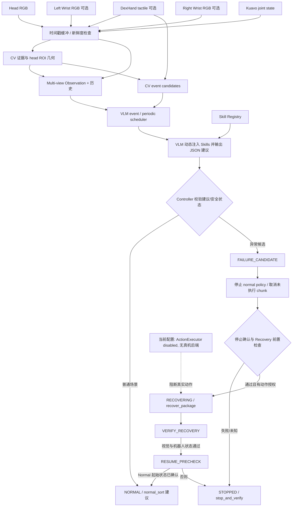

# Kuavo VLM Skill Routing / Recovery Harness

这个目录实现的是 Kuavo 包裹分拣的 VLM 技能路由与恢复控制框架。它把相机图像、可用的 CV 证据、触觉接触、机器人状态和 Skill Registry 一起交给 VLM；VLM 只提出技能建议，控制器再检查新鲜度、机器人状态、停止确认、目标定位、碰撞检查和 checkpoint 状态。

**当前支持离线 VLM 路由、ROS 只读 live dry-run、异步 VLM 调度和离线 mock 执行。没有任何模式会隐式发送机器人动作。** mock policy/action backend 仅用于软件闭环，不加载 VLA、不连接 ROS motion interface。真机动作仍被禁止：真实 Kuavo executor、安全状态/停止确认和 Recovery HF export 尚未接通。

## 整体工作流程



### 1. 读取配置和技能注册表

入口 [run.py](run.py) 从 [package_sorting.yaml](config/package_sorting.yaml) 读取运行配置，再加载 [skill_registry.yaml](config/skill_registry.yaml)。Registry 是 VLM 可推荐 Learned VLA Skills 的唯一来源，初始注册：

- `normal_sort`：一个完整的双臂 Pick–Flip–Place 任务。左臂从传送带取包裹并放到黄色平台；右臂按需翻转，再放入篮子。
- `recover_package`：左臂从黄色平台身体侧的异常位置重新抓取包裹，并放回平台。
- `stop_and_verify`：控制器动作，不是 VLA Skill。

每个 Skill 配置包含任务描述、task instruction、checkpoint 与 selector、base/source model 路径、normalization、pre/postconditions、支持场景、timeout 和 execution status。每次推理时 `SkillRegistry.prompt_descriptions()` 从当前 Registry 生成完整的 Available Skills 文本；Prompt 本身不维护第二份硬编码 Skill 清单。

启动前可运行不加载模型的路径检查：

```bash
PYTHONPATH="$PWD${PYTHONPATH:+:$PYTHONPATH}" python3 -m recovery_harness.run preflight
```

### 2. 收集和整理观测

`KuavoSensorBridge` 是只读 ROS bridge，不创建动作 publisher 或运动 service client。话题由配置决定，默认包括：

| 数据 | 默认 ROS topic | 用途 |
|---|---|---|
| Head RGB | `/cam_h/color/image_raw/compressed` | 全局任务场景、平台和篮子 |
| Left Wrist RGB | `/cam_l/color/image_raw/compressed` | 可选的身体侧目标和抓取/释放辅助视角 |
| Right Wrist RGB | `/cam_r/color/image_raw/compressed` | 可选；默认关闭 |
| DexHand tactile | `/dexhand/touch_state` | 左右手五指的多指接触摘要 |
| Kuavo joints | `/sensors_data_raw` | 当前 joint state；不等同于安全或停止状态 |
| Operator pause | `/kuavo/pause_state` | `true` 暂停 dry-run 的 VLM 调度；`false` 恢复 |
| Operator stop | `/kuavo/stop_state` | `true` 锁存停止请求、取消策略并令 FSM 进入 `STOPPED` |

图像放入各自的 `TimestampedBuffer`。ROS `header.stamp` 为 0 或无效时会标记为 receipt-time 来源。推理前会过滤过期图像/触觉；VLM 推理完成后会重新检查**实际用于该次推理的图像**以及最新机器人状态，防止耗时推理让旧建议直接生效。各相机分别取最近的新鲜帧，当前实现不是严格的跨相机硬件时间同步器。

CompressedImage 由 Pillow 从 JPEG/PNG 数据直接解码为 RGB，不调用 ROS `cv_bridge` 的二进制扩展，避免其与当前 Python 环境 NumPy ABI 不兼容导致的崩溃。

近期历史只记录之前的 VLM 建议与感知结果，不把旧目标位置当作当前确认位置。Left/Right Wrist 图像作为独立视角输入；没有标定时不会把 wrist 像素转换成 head 坐标。

### 3. CV 与几何证据

`PerceptionAdapter` 负责合并可选 detector/tracker 输出和 head ROI 几何证据：

1. 默认 `perception.detector_plugin` 指向 `recovery_harness.plugins.grounding_dino_sam2:create_detector`。插件从 `yolo/motion_tracking_benchmark/sam2_video_adapter.py` 动态导入并复用已有 `_make_dino_detector` 与遮挡覆盖率 helper；Grounding DINO、SAM 2.1 源码、配置和权重均使用本机已有路径，不会下载或训练模型。
2. 插件首次创建时只加载一次 Grounding DINO 与 SAM 2.1。每 5 个新的 head 帧运行一次 DINO，最多保留 6 个蓝/粉包裹实例，并用 DINO 框和上一帧低分辨率 mask prompt 调用 SAM2 image predictor 更新可见 mask。该在线入口复用已有 DINO 推理、SAM2 模型配置/权重；既有离线视频传播实现仍保留在 `sam2_video_adapter.py`。Mask/框之间以 IoU 关联多目标；机器人手臂高度覆盖的提议剔除，较小遮挡或触及画面边界会标记为 partial/occluded。SAM2 失败的实例不会被转成包裹越界事件。
3. 本机资源：DINO snapshot 位于 `/home/kuavo/.cache/huggingface/hub/models--IDEA-Research--grounding-dino-tiny/snapshots/a2bb814dd30d776dcf7e30523b00659f4f141c71`；SAM2 源码 `/media/data/jiayi/sam2`、配置 `sam2/configs/sam2.1/sam2.1_hiera_s.yaml`、权重 `checkpoints/sam2.1_hiera_small.pt`。配置指定 `cuda:1`。缺少依赖或这些路径时，插件会报告具体依赖/路径并停止初始化，不会替换为虚构模型。
4. Head ROI JSON `/media/data/jiayi/dataset/roi_config.json` 提供 `platform_polygon` 与 `body_side_edge`。对实际可见 mask 的前景像素计算落在平台内和身体侧边缘外的数量。只有包裹可见 mask 在边缘两侧均有足够像素时，才确认可见部分跨边；它不估计遮挡部分或包裹完整物理 footprint。只在传送带区域可见、没有平台像素支撑的包裹不成为 CV recovery event 候选。
5. 越界事件 `POSSIBLE_PACKAGE_OUTSIDE_PLATFORM` 还要求完整/未遮挡的 mask、包裹类别、足够的 DINO/SAM2 置信度和足够新的 detector 证据。partial/occluded 包裹只产生带不确定性的 `SCENE_UNCERTAIN` 事件；无检测、空场景或无 ROI 不会凭空产生异常。CV 只负责安排 VLM 推理时机；最终由 VLM 根据 Registry 当前技能描述动态选择技能。
6. SAM2 mask 遮罩仅是当前图像中的可见区域；不把它或任何 bbox 扩展解释为隐藏实体。Wrist 图像不套用 head ROI，仍由 VLM 独立理解。

感知上下文包括 `package_visible`、`package_partially_visible`、`package_occluded`、`package_location`、`body_side_violation`、`overlap_ratio`、`geometry_validity`、track age/source 和 ROI 像素坐标。证据不足时显式使用 `unknown`。

#### Grounding DINO package candidate regression（离线、默认不启用）

`recovery_harness.detection` 提供可独立测试的候选处理逻辑；新增 detector 支持 `per_class`、`joint_plus_per_class`、`legacy_joint` 和仅诊断用的 `generic` 查询模式。默认插件仍使用原有路径，`package_sorting.yaml` 未切换到新模式。新路径会保留原始 phrase/score/box、阈值前 proposal、prompt 来源、候选去重证据、各过滤阶段决定和 arm/package 冲突。多个合法类别同时匹配时保留为 `ambiguous`；arm overlap 只有在 arm 框同时满足帧边缘锚定、细长几何和原 arm 分数下限时才拒绝候选，其余高重叠情况保留为不可执行的歧义诊断。

可在已有 `lingbotvla` 环境和本地 DINO snapshot 上复现手工标注帧的比较；此命令只加载 DINO，不连接 ROS/VLA，也不调用 SAM2：

```bash
PYTHONPATH="$PWD${PYTHONPATH:+:$PYTHONPATH}" python3 -m recovery_harness.candidate_regression \
  --manifest recovery_harness/outputs/candidate_pipeline_regression/annotations.json \
  --model-path /home/kuavo/.cache/huggingface/hub/models--IDEA-Research--grounding-dino-tiny/snapshots/a2bb814dd30d776dcf7e30523b00659f4f141c71 \
  --device cpu
```

结果写入 `outputs/candidate_pipeline_regression/results/`，包括阈值前候选、完整过滤审计、每帧叠图和手工样本汇总。只有在后续 monitor-only dry-run 中显式设置 detector 插件的 `candidate_pipeline_mode: per_class` 才会使用新推理路径；该设置不会启用动作。手工小样本指标用于本次回归对照，不代表泛化性能。

### 4. 触觉接触状态

`BinaryContactProcessor` 对每根手指把三个 normal-force channel 相加，按每指阈值转成二值接触；至少两根手指接触并持续 100 ms 才输出该手的 `multifinger_contact=1`。触觉仅表示接触，不能单独证明抓住了目标。

当前 `finger_force_thresholds` 与 `valid_status_values` 默认是 `null`。驱动源码只声明 `status` 是整数，没有给出其状态含义；真实传感器的无载基线也未标定。因此默认触觉状态是 `UNKNOWN`，不会猜阈值或 status 语义。离线 JSONL manifest 可以显式提供 `left_multifinger_contact` / `right_multifinger_contact`。

### 5. VLM 场景理解与技能推荐

`SceneReasoner` 每次根据当前 Registry 动态构造 Prompt，并输入：

- 当前可用的 Head RGB 和启用的 Wrist RGB；
- 可选 CV/tracking/ROI 几何证据；
- 最新触觉接触摘要；
- 简化后的 robot state、观测 freshness 和近期历史；
- 从 Registry 即时生成的 Available Skills 描述及合法输出集合。

`QwenVLMAdapter` 根据配置只加载一个模型：`qwen2_5_vl` 使用 Qwen2.5-VL model class；`qwen3_vl` 使用 Qwen3-VL class。Processor 和 chat template 从所选本地模型目录读取。VLM 输出 JSON 字段为 `scene_state`、`task_progress`、`recommended_skill`、`target_object`、`reason` 和 `requires_verification`。只接受 Registry 中的 Skill ID 或 `stop_and_verify`；JSON 错误、非法 Skill 或推理异常都会 fail-closed 到停止核验。

VLM 只是建议者。它不拥有动作执行权限，也不生成关节命令、IK 或碰撞检查结果。

Live dry-run 使用 `EventTrigger` 和单 worker `VLMInvocationScheduler`：稳定 CV 异常需满足配置的连续帧数；已校准的 `BinaryContactProcessor` 输出接触状态转变时可立即触发；独立周期推理作为低频兜底。事件只决定何时推理，不决定技能。调度时在调用前检查输入图像年龄是否不超过 `max_observation_age_seconds`；VLM 结果年龄按 `max_vlm_result_age_seconds`（默认 3 秒）分别在推理线程完成时和 ROS 主循环取用时检查。过期结果会记录解析出的推荐，但不会传给 `RecoveryController`。日志分开记录生成延迟、推理线程总耗时、完成时结果年龄和主循环取用时结果年龄，以区分模型慢和主循环晚取结果。ROS 主循环每 50 ms 调度，不等待 VLM 返回。

每次成功解析出 VLM 推荐（包括 stale 结果）都会在 `runtime.diagnostic_output_dir` 保存同步诊断目录，默认是 `outputs/recovery_harness/live_dry_run_diagnostics`。目录包含该次推理实际使用的头部相机帧、平台 ROI 轮廓与裁剪图、Grounding DINO 框、SAM2 mask 和分割框、CV event candidates、mask 与平台/身体侧区域的像素交集统计、freshness 数据、VLM 原始推荐、结果分类和 Controller dry-run 决策。`snapshot.json` 汇总每个包裹的检测与区域交集。推理没有返回解析结果时不会生成这类快照。

推理 profile 会记录模型 `hf_device_map`、CUDA 可用性、attention backend、processor 类型，以及图像预处理、输入传输、同步后的 generation、JSON decode、总耗时、输入/输出 token 数和 Qwen image grid 尺寸。另记录 VLM 完成后的主循环取用延迟和取用这一轮花在 CV 上的时间。传给后续 Prompt 的 history 使用精简字段，避免每轮重复塞入完整 Registry 描述。

### 6. Controller FSM 与安全门

`RecoveryController` 区分 VLM 推荐、Controller 选择和实际 VLA 执行。FSM 状态为：

`NORMAL → FAILURE_CANDIDATE → STOPPING → RECOVERY_PRECHECK → RECOVERING → VERIFY_RECOVERY → RESUME_PRECHECK → NORMAL`

任何前置条件失败或状态未知都进入 `STOPPED`；全任务完成需另行确认全部六个包裹在篮子中及机器人安全。核心检查包括：

- 用于建议的图像和当前 robot state 是否新鲜、有效，`safety_ok` 是否明确为 true；
- Normal policy 是否停止、待执行 action chunk 是否取消、机器人是否有停止确认；
- Recovery 目标是否可靠定位、恢复 checkpoint 是否可加载、碰撞检查是否通过；
- Recovery 后目标是否仍可见并已回到平台、机器人是否安全。当前 `verify_recovery` 只在 tactile 明确为 `1` 时拒绝；tactile 为 `UNKNOWN` 不会证明夹爪已释放，所以真机接入前还需加上可信 gripper/release 确认；
- Normal full-task policy 是否支持 Recovery 后的初始状态。不能默认 Normal policy 能从任意状态恢复。

`ActionExecutor` 默认 `enabled=False` 且没有 backend。即使 VLM 推荐了 `recover_package`，没有停止确认、碰撞/定位检查和显式动作授权也不能开始恢复。Policy adapter 按需加载当前 Skill，切换时卸载旧模型并清理 pending chunk，避免两个 VLA 同时常驻。

### 7. 策略执行、恢复验证和继续分拣

代码中的 `LingBotPolicyAdapter` 复用仓库现有 `kuavo_server.adapters.lingbot_vla.LingBotVlaAdapter`，包括它的 LingBot inference、task prompt、norm stats 和 action chunk 入口。控制器提供 `start_normal`、`begin_recovery`、`step_active_policy`、`finish_recovery_execution`、`verify_recovery` 和 `approve_resume` 等门控接口。

完整真机序列预期为：停止 Normal 并确认机器人停稳 → 检查 Recovery 前置条件 → 加载 `recover_package` → 在授权的 executor 下逐步执行 action chunk → 等待独立的视觉/状态验证 → 仅在 Normal 起始状态支持性得到确认后重载并继续 `normal_sort`。如果任何一步不确定，停止并等待人工处理；不执行自动 Reset 或探索动作。

离线 `--mock-execution` 可将经 VLM 路由后的决定交给 FSM，再调用纯 Python mock policy/action backend。Recovery 流程需要 manifest 明确提供 `mock_prechecks`、`mock_verification` 和 `mock_resume`；这些字段是合成测试输入，不可表示真实安全信号。该模式不加载 LingBot VLA，不创建 ROS publisher/service，也不会下发动作。验证成功还必须提供明确 `release_confirmed=true`；未知 tactile 或 action chunk 完成不构成释放证明。

## Checkpoint 和资源状态

- Normal checkpoint：用户提供的 `task3_package_lora` 路径在当前服务器不存在；实际找到的是 `/media/data/jiayi/outputs/kuavo_lingbotvla/task3_pacakge_lora/global_step_66480/hf_ckpt`（目录确实拼作 `pacakge`）。这是含 `config.json` 与 safetensors 的 HF checkpoint，可由现有 adapter 解析。
- Recovery checkpoint：配置固定选择 `global_step_28300`。该目录为多 rank DCP (`model/*.distcp`、`.metadata`)，不是现有 HF-only inference adapter 可直接加载的导出格式。需先转换并验证 HF export，再在 `skill_registry.yaml` 设置 `exported_hf_checkpoint`；本 harness 不转换或修改模型权重。
- VLM 默认配置为本地 Qwen2.5-VL-7B；改为 `backend: qwen3_vl` 和 Qwen3 本地目录即可选择 Qwen3-VL-4B。运行时只加载所选的一个 VLM。

## 可运行模式

所有命令从仓库根目录执行，并在相应环境中安装 ROS、LingBot 和 Transformers 运行依赖。

### Preflight（不加载模型）

```bash
PYTHONPATH="$PWD${PYTHONPATH:+:$PYTHONPATH}" python3 -m recovery_harness.run preflight
```

此命令会核对 VLM、VLA base/source、norm stats、training config、robot config 和 checkpoint。当前预期是 Normal ready，Recovery 因 DCP 格式不能被 HF inference adapter 加载而报告失败。

### Offline 图片 replay（只运行 VLM，不执行 VLA）

JSONL 每行代表一个观测样本，图片路径相对当前工作目录。可选添加 wrist 图、timestamp、`robot_state`、`tactile` 和 label。结果默认打印；`--output` 可附加写入结果 JSONL。每次最多 10 帧：

```json
{"label":"recovery_sample","head_image":"vlm_test/recovery_rgb_tactile/images/frame_00004.jpg","left_wrist_image":null,"robot_state":{"valid":true,"safety_ok":true,"motion_state":"stopped"},"tactile":{"left_multifinger_contact":null,"right_multifinger_contact":null}}
```

```bash
PYTHONPATH="$PWD${PYTHONPATH:+:$PYTHONPATH}" python3 -m recovery_harness.run offline \
  --manifest recovery_harness/examples/replay.example.jsonl \
  --max-frames 10 \
  --output outputs/vlm_test/replay_results.jsonl
```

前一轮 Qwen2.5-VL-7B routing probe 使用 2 帧 Normal 和 3 帧 Recovery。模型没有区分 Recovery 初始异常位置，详情见 [测试结果 JSONL](../outputs/vlm_test/skill_routing_probe_qwen25_7b.jsonl) 和 [测试摘要](../outputs/vlm_test/skill_routing_probe_qwen25_7b_summary.md)。之后增加的 ROI 坐标上下文尚未重新做 VLM 推理。

### Live sensor-only dry-run（ROS 只读，VLM 异步调度，不运行 VLA/动作）

```bash
PYTHONPATH="$PWD${PYTHONPATH:+:$PYTHONPATH}" python3 -m recovery_harness.run live-dry-run \
  --max-observations 10
```

`--max-observations 0` 表示持续运行到 Ctrl-C。该模式订阅配置中的 ROS 图像、触觉和关节状态，加载一个所选 VLM，周期/事件触发推理并输出触发证据、推理 freshness、推荐与 controller decision。它不创建动作 publisher/service，也不加载 VLA。

它也订阅 `real_single_test.py` / `sim_auto_test.py` 使用的 pause/stop Bool topics：pause 为真时不调度新推理，暂停期间完成的推理结果会丢弃；stop 为真时锁存请求，调用 policy/executor 的 stop 请求并将 controller 置为 `STOPPED`。这些信号只是操作员请求。尤其 `/kuavo/stop_state` 不是机器人已物理停稳的确认，不能替代 recovery precheck 所需的 stopped acknowledgement。`sim_auto_test.py` 的 `/simulator/init`、`/simulator/success` 与 `/simulator/reset` 仅用于仿真 rollout，不适用于本 harness，也不会在这里调用。

### Offline VLM + mock policy/action orchestration

```bash
PYTHONPATH="$PWD${PYTHONPATH:+:$PYTHONPATH}" python3 -m recovery_harness.run offline \
  --manifest recovery_harness/examples/replay.example.jsonl --max-frames 10 --mock-execution
```

该命令调用配置的 VLM；VLA policy 和 Kuavo backend 均替换成显式 mock。要覆盖模拟 Recovery/Resume，manifest 中必须提供明确标为 mock 的前置条件、视觉/释放验证和 Normal 初始状态支持字段。输出 `robot_motion:false` 表示纯软件模拟。

### Real-robot preflight (currently refused)

```bash
PYTHONPATH="$PWD${PYTHONPATH:+:$PYTHONPATH}" python3 -m recovery_harness.run real-robot
```

当前命令 fail-closed 并列出缺失接口；不会尝试加载 VLA 或创建动作 client。

## 当前限制与真机前必须完成的事项

1. 选择的 Recovery DCP checkpoint 需要导出为现有 LingBot 推理入口支持的 HF safetensors，并验证权重/配置/base model 对应关系。
2. DexHand 每指阈值需用真实无载基线校准，`status` 合法值需从驱动定义确认；否则 tactile 保持 `UNKNOWN`。
3. `/sensors_data_raw` 在当前 bridge 中只证明有 joint state，不提供 `safety_ok`、机器人是否停稳、gripper 是否释放或 collision-free 状态。需接入可信状态提供器。
4. 需实现和验证 site-specific Kuavo `ActionExecutor`，覆盖 action 单位、限幅、控制模式、chunk 取消、停止确认和故障停机。当前代码不实例化会进入控制设置的 `KuavoRealEnv`。
5. 需在实机环境验证完整 Normal → Stop → Recovery → Verify → Resume 流程，并验证 Normal full-task policy 对 Recovery 后状态的支持性。

## 验证状态与剩余集成阻塞

- **实现并由单元测试覆盖**：Registry 描述/推荐合法性、CV/触觉事件候选、单 worker 事件/周期调度、重复事件合并、过期结果拒绝、FSM 路由与 fail-closed、Recovery 释放证据门、mock backend 无 ROS/motor 连接、真实 backend 缺失时报错。
- **本次实际验证**：只运行轻量 Python unittest 与语法编译；未加载 Qwen/VLA，没有 ROS 运行环境联调，也没有真机测试。
- **真实 ROS 观察**：只读订阅代码已存在，但本次没有启动 ROS，不能声称本次验证了 live observations。
- **真机未验证且 real-robot CLI 当前拒绝执行**：需要 Kuavo action backend（动作单位/限幅/模式）、活动 policy 停止确认、pending chunk drain/cancel 确认、可信 stopped acknowledgement、joint/end-effector validity、collision/safety checker、gripper release evidence、Recovery HF checkpoint export 和 deployment authorization。
- `/sensors_data_raw` 当前只提供 joint 数据；没有证据说明它包含安全、停稳、碰撞或夹爪释放状态。`/kuavo/stop_state` 也未验证为本 harness 停止确认，因此不会被当作安全信号。
- Pause/stop topic 的消息类型和语义按 eval 脚本使用的 `std_msgs/Bool` 接入；它们可停止 harness 的推理/控制流程，但不会单独发布或保证硬件急停。
- Grounding DINO + SAM2 插件与本机路径已接入默认 live/offline 配置；本次只验证静态代码与合成图形，不曾加载模型或验证真实画面推理。CV mask 是 image-space 可见区域证据，不是对包裹完整 footprint 或物理支撑状态的判定。

本次没有执行模型训练、checkpoint 转换、完整数据集 replay 或真机动作。机器人运动保持禁用。
